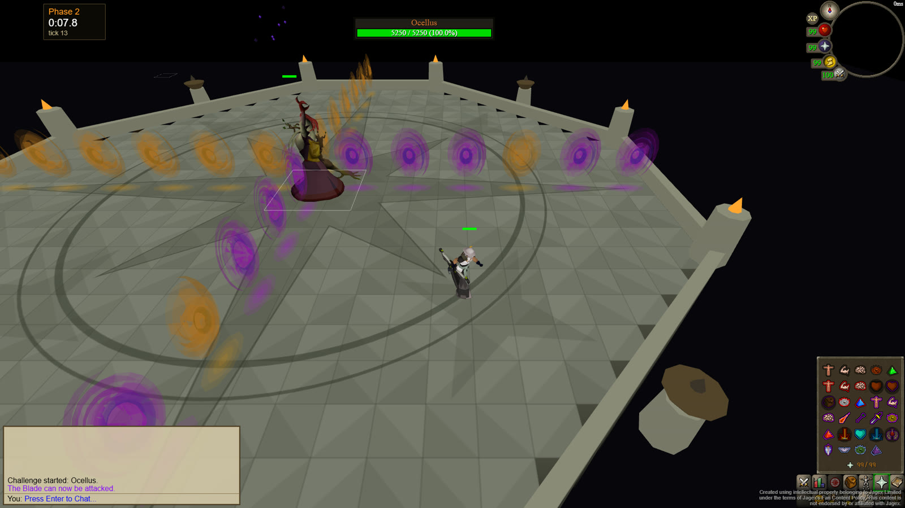
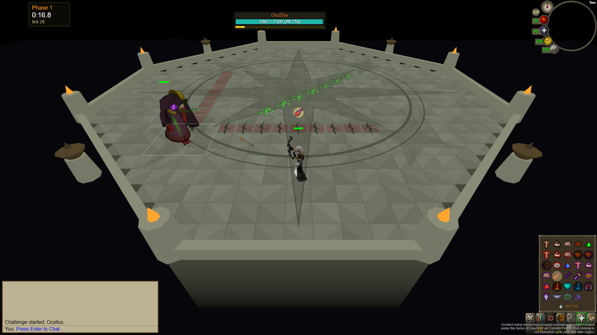
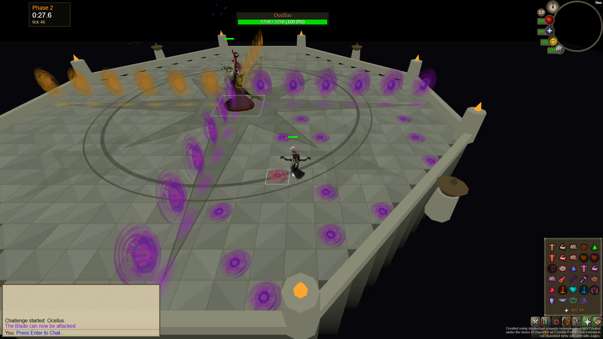
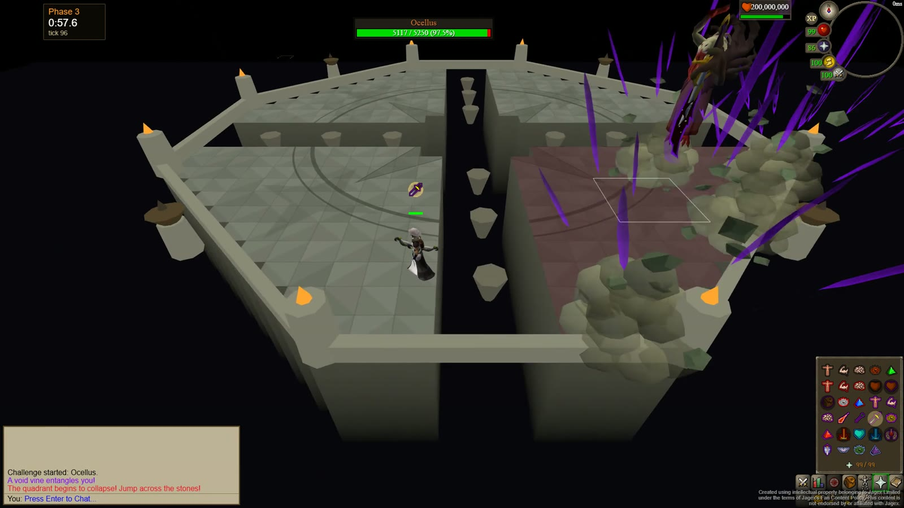
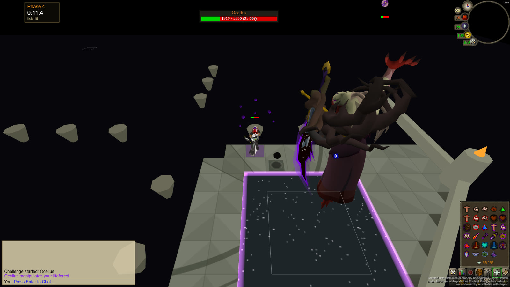
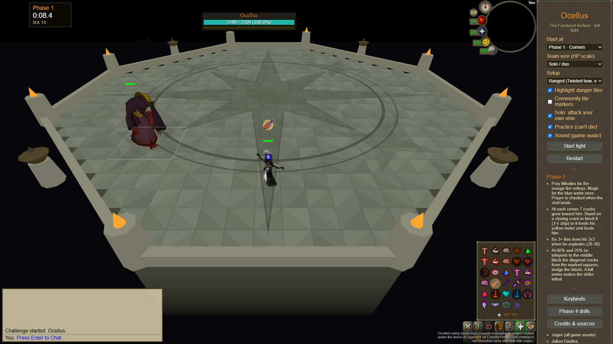

<div align="center">

# Ocellus Simulator

**Practise the whole Ocellus fight from The Fractured Archive (OSRS Raid 4), all four phases, in your browser.**

[**▶ Play it at ocellus-sim.pages.dev**](https://ocellus-sim.pages.dev)

[](https://ocellus-sim.pages.dev)
[](LICENSE)
[](https://x.com/alrodi)



</div>

Ocellus is drawn from the game's own models, animations, effects and sounds, extracted from the OSRS cache at build
time. His attacks follow a tick-by-tick analysis of recorded kills. No download and no account: open the link and
fight.

> Created using intellectual property belonging to Jagex Limited under the terms of Jagex's Fan Content Policy. This
> content is not endorsed by or affiliated with Jagex.

## What's in it

- **All four phases in one fight**, with the transformations between them, or start at any phase.
- **Game assets**: cache models and animations for every body he takes, the phase 2 portals, rifts, the vine, his
  spells, and the sounds each animation plays.
- **Prayer that matters**: shots are checked against your overhead when they land, his own overheads block your
  style, and turning on a protection prayer as he starts to spin gets you "injured".
- **Practice tools**: danger-tile highlighting, community tile markers, phase 2 skip tiles, a no-death practice mode,
  ranged and melee setups, seeds you can replay, and F-key bindings for the side-panel
  tabs (saved in your browser).
- **Phase 4 drills**: Julian-Dasilva's original phase 4 trainer, kept as `?mode=p4drill`.

## The fight

<table>
<tr>
<td width="50%"></td>
<td>

**Phase 1 · Corners** (2,500 HP, teal bar)

He walks corner to corner under Protect from Melee, firing fire (ranged) or water (magic) volleys. At each corner
seven crack lines grow toward him: stand on them as they close, or each one heals him and fills his yellow meter. Then
he explodes. At 66% and 25% he teleports to the middle for diagonal cracks and a strike that grows with the meter.

</td>
</tr>
<tr>
<td>

**Phase 2 · The Blade** (5,250 HP pool, green bar)

A fixed 131-tick script. Twenty-four portals form a "+". Every five ticks ten of the twelve portals around your
quadrant light purple; the one orange portal left on each arm marks the safe spot, where their two lines cross. The gaps
follow the game's three fixed patterns, in the game's order, so the rounds can be learnt. Then pools, an orange floor portal to the next quadrant, and all twelve fire at once.

</td>
<td></td>
</tr>
<tr>
<td></td>
<td>

**Phase 3 · Quadrants**

The "+" breaks into chasms with stepping stones. Three segments, each ending with your quadrant falling into the
void: melee triples and the shadow slash, spins, void bombs, "Your panic... is futile...", the Void Vine,
"Insolence...", rifts, and Untether. Jump the stones before the floor goes. The void bombs land where you stand and on
the same tile of every other quadrant, and stay: rag them to the edge or meet them again in phase 4.

</td>
</tr>
<tr>
<td>

**Phase 4 · Last quadrant**

A 60-tick loop: inner void and Deflect Melee, a wind that halves your HP, personal explosions, a hybrid attack under
Soul Split, then outer void and Deflect Range. Take your lifeforce orb back before he does. Dodge an explosion by one
tile and your attack timer resets: move, attack, move for 2-tick Tbow or Scythe.

</td>
<td></td>
</tr>
</table>

<p align="center"></p>

## Options

Everything is in the sidebar, and each option is also a URL parameter, so a setup can be shared as a link:

| Parameter | Values | |
|---|---|---|
| `phase` | `1`-`4` | where the fight starts |
| `setup` | `ranged`, `melee` | your gear |
| `tiles` | `0`, `1` | highlight danger and safe tiles |
| `markers` | `0`, `1` | community tile markers |
| `skip` | `0`, `1` | mark phase 2's skip tiles (stand 6 out diagonally, run to 4 out) |
| `pattern` | `0`, `1` | number phase 2's safe spots, wave 1 to 6, in each pattern's colour (orange, red, green) |
| `vine` | `0`, `1` | solo rule: attack your own vine |
| `practice` | `0`, `1` | you can't die |
| `seed` | a number | replay the same fight |
| `mode` | `p4drill` | the original phase 4 trainer |

## How accurate is it?

Timings come from MRobertEvers' RSProx analysis of six recorded fights, matched to the tick, plus the OSRS Wiki and
ShadowStalkerTM's duo kill for the visuals. Some damage numbers and a few rules are still unknown, and the arena floor
is drawn by hand because the cache's map data is encrypted. [docs/SOURCES.md](docs/SOURCES.md) lists every source and
every open question. If something doesn't match the game, open an issue with a clip or a tick count.

## Development

Requires Node 22 and, on Windows, Git Bash.

```sh
npm ci
scripts/install-beta-sdk.sh   # the beta osrs-sdk packages, installed without saving; rerun after any npm ci
npm run assets -- --cache-dir <openrs2 cache dir> --reader-path <osrscachereader checkout>
npm start                     # http://127.0.0.1:8002
```

`npm run assets` downloads OpenRS2 cache 2746 (213 MB, once) and extracts every model, animation, effect and sound the
fight uses into `public/osrs-assets/`, which is never committed. It also draws the inventory icons from the items'
cache models and writes the boss's overhead icons from the cache's sprite index. The cache reader is
[Julian-Dasilva/osrscachereader](https://github.com/Julian-Dasilva/osrscachereader) at `8ba9131`.
`scripts/patch-sdk-assets.mjs` fixes the beta asset tool on Windows and lets it skip sounds the cache doesn't ship.

The browser console exposes `__ocellus` for testing: `state()`, `pray("magic")`, `walk(x, z)`, `click(x, z)`,
`bossHp(0.5)` and `speed(ms)`.

### Code map

```
src/content/ocellus/fight/
  data.ts         every id, timing and damage range, with its source
  geometry.ts     arena coordinates (x east, z north from the middle) and the octagonal room
  Fight.ts        the director: tick scheduler, hits checked against prayer on landing, floor, chat
  phase1.ts .. phase4.ts   one script per phase
  arena.ts        the room: engraved floor, cliffs, stepping stones, censers, torches
  effects.ts      cache spotanims on tiles, danger-tile overlay, void floor
  portals.ts      phase 2's portals, the game's own objects
  units.ts        Ocellus's bodies, the vine and rifts, the player
  bossBar.ts      the game's teal-then-green boss bar with the phase 1 meter
src/FightApp.tsx  the page: HUD, chatbox, sidebar, loading splash, result panel
```

### Deploying

The site is a static `dist/` hosted on [Cloudflare Pages](https://pages.cloudflare.com) at
[ocellus-sim.pages.dev](https://ocellus-sim.pages.dev), built from this repository: every push to `main` goes live.
Pages runs `bash scripts/build.sh && node scripts/pages-postbuild.mjs && rm -f dist/main.js.map` and publishes `dist`.
`npm run deploy` does the same from your machine and uploads it with Wrangler (log in once with `npx wrangler login`):

- `scripts/build.sh` installs the pinned beta SDK and cache reader, downloads the cache, extracts the assets and runs
  webpack (about four minutes).
- `scripts/pages-postbuild.mjs` splits any asset over Pages' 25 MiB file limit (phase 3's body is ~33 MB) into parts
  that `src/splitAssets.ts` joins back in the browser, and writes `_headers` so the hashed model files are cached as
  immutable.

The old address, `ocellus-sim.vercel.app`, permanently redirects to Pages (`vercel.json`).

## Credits

- **Julian-Dasilva**: [ArchiveOcellusTrainer](https://github.com/Julian-Dasilva/ArchiveOcellusTrainer), the phase 4
  trainer this grew from (play it at
  [archive-ocellus-trainer.raid-sims.workers.dev](https://archive-ocellus-trainer.raid-sims.workers.dev)), and the
  cache reader fork.
- **ShadowStalkerTM**: [Duo The Fractured Archive | OSRS Raid 4](https://www.youtube.com/watch?v=HAgq_qg0OIY), the
  reference fight.
- **MRobertEvers**: the RSProx tick analysis in
  [oldschool-clientc](https://github.com/MRobertEvers/oldschool-clientc).
- **OldSchoolSDK / Supalosa**: [osrs-sdk](https://github.com/OldSchoolSDK/osrs-sdk), the engine behind
  [colosim.com](https://colosim.com) and [infernotrainer.com](https://www.infernotrainer.com).
- **The OSRS Wiki editors**: [Ocellus](https://oldschool.runescape.wiki/w/Ocellus).
- **Jagex**: every game asset. No game files are stored in this repository; they are extracted from the cache when
  the site builds.

Made by [@alrodi](https://x.com/alrodi). Follow for updates and new sims.

## Licence

GPL-3.0, like the trainer it forks and osrs-sdk. See [LICENSE](LICENSE).
